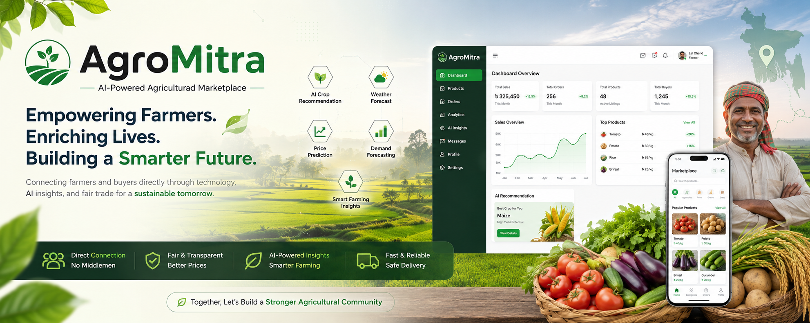

# 🌾 AgroMitra

### AI-Powered Smart Agriculture Marketplace for Bangladesh

<p align="center">
  
</p>
<p align="center">

</p>
<p align="center">
<b>Empowering Farmers with Artificial Intelligence, Fair Trade, and Digital Agriculture.</b>
</p>

<p align="center">


</p>

---

# 🚀 Overview

AgroMitra is an AI-powered smart agriculture marketplace that connects farmers directly with buyers through a secure, transparent, and intelligent digital platform.

The system eliminates unnecessary middlemen while helping farmers make data-driven decisions using Artificial Intelligence.

The platform integrates modern web technologies with Machine Learning models to provide crop recommendations, price prediction, weather intelligence, demand forecasting, and smart farming assistance.

Developed as a **Final Year B.Sc. in Computer Science & Engineering Project** at **Uttara University**.

---

# ✨ Key Features

## 👨‍🌾 Farmer Dashboard

- Product Management
- Add / Update / Delete Products
- AI Crop Recommendation
- Price Prediction
- Weather Intelligence
- Order Management
- Sales Analytics
- Dashboard Statistics
- Inventory Management

---

## 🛒 Buyer Marketplace

- Modern Marketplace UI
- Product Search
- Category Filter
- District Filter
- Wishlist
- Shopping Cart
- Checkout
- Order Tracking
- Order History
- Product Review & Rating

---

## ⚙️ Admin Dashboard

- User Management
- Product Monitoring
- Marketplace Analytics
- Order Management
- Platform Fee Management
- Reports
- System Configuration

---

## 🤖 Artificial Intelligence

- Crop Recommendation
- Crop Price Prediction
- Weather Forecast
- Demand Forecasting
- Smart Farming Suggestions
- Fair Price Analysis
- Market Intelligence

---

## 🌐 Platform Features

- JWT Authentication
- Role-Based Access Control
- Responsive Design
- Dark Mode
- English & Bengali Support
- Secure REST API
- Profile Management
- Notification Settings
- AI Integration

---

# 🏗 System Architecture

```
                 AgroMitra Platform

                        │

        ┌───────────────┼───────────────┐
        │                               │

 React Frontend                FastAPI Backend

        │                               │

        │                 AI Prediction Engine

        │                               │

        └──────────── PostgreSQL Database
```

---

# 📂 Project Structure

```
repository-root/
├── .github/
│   └── workflows/ci.yml
├── README.md
├── LICENSE
└── AgroMitra/                 # application source lives in this inner folder
    ├── backend/
    │   ├── ai_models/         # AI code, artifacts, and source data
    │   ├── database/
    │   │   ├── models/        # SQLAlchemy models
    │   │   ├── routes/        # FastAPI routers
    │   │   ├── schemas/       # Pydantic schemas
    │   │   ├── scripts/       # Database utility scripts
    │   │   └── utils/         # Authentication, order, and domain helpers
    │   ├── tests/             # Backend tests
    │   ├── test-requirements.txt
    │   ├── .env.example
    │   └── main.py            # FastAPI application entry point
    ├── frontend/
    │   ├── src/
    │   │   ├── api/
    │   │   ├── assets/
    │   │   ├── components/
    │   │   ├── hooks/
    │   │   └── pages/
    │   ├── .env.example
    │   └── package.json
    ├── start-backend.bat
    └── pytest.ini
```

---

# 🛠 Tech Stack

## Frontend

- React 19
- Vite
- React Router
- Axios
- Recharts
- React Icons
- CSS3

---

## Backend

- FastAPI
- Python 3.11
- SQLAlchemy
- PostgreSQL
- JWT Authentication
- Pydantic

---

## AI / Machine Learning

- TensorFlow
- Prophet
- XGBoost
- Pandas
- NumPy
- Scikit-learn

---

# 🚀 Installation

## Clone Repository

```bash
git clone https://github.com/lalchandali/AgroMitra-project.git

cd AgroMitra-project/AgroMitra
```

---

# Backend

```bash
cd backend

python -m venv .venv
```

Linux

```bash
source .venv/bin/activate
```

Windows

```bash
.venv\Scripts\activate
```

Install Packages

```bash
pip install -r requirements.txt
cp .env.example .env
```

On Windows PowerShell, use `Copy-Item .env.example .env` instead of `cp`.
Then set the PostgreSQL
`DATABASE_URL`, a unique `JWT_SECRET_KEY`, and any optional external API keys.
The example documents each supported backend setting; do not commit real
credentials. A PostgreSQL database must be available before starting the API.

Run Server

```bash
uvicorn main:app --reload
```

Server

```
http://127.0.0.1:8000
```

Swagger

```
http://127.0.0.1:8000/docs
```

---

# Frontend

Open a second terminal and, from the cloned repository root, enter the inner
application's frontend folder:

```bash
cd AgroMitra-project/AgroMitra/frontend

npm ci
cp .env.example .env

npm run dev
```

On Windows PowerShell, use `Copy-Item .env.example .env` instead of `cp`.
Configure `VITE_API_URL` in the copied env file.
The development default points to `http://localhost:8000`.

Frontend

```
http://localhost:5173
```

---

# API Documentation

| Documentation | URL    |
| ------------- | ------ |
| Swagger       | /docs  |
| ReDoc         | /redoc |

---

# 🧪 Tests and CI

From the inner `AgroMitra/` application directory:

```bash
python -m pip install -r backend/test-requirements.txt
python -m pytest -q backend/tests
cd frontend
npm ci
npm run build
```

GitHub Actions runs the backend tests and frontend production build on pushes
and pull requests. The backend health endpoint is available at `/health` and
reports whether its database connection probe succeeds.

---

# 🤖 AI Modules

| Module              | Description                  |
| ------------------- | ---------------------------- |
| Crop Recommendation | Suggest suitable crops       |
| Price Prediction    | Predict future market price  |
| Weather Forecast    | Weather intelligence         |
| Demand Forecast     | Estimate market demand       |
| Smart Suggestion    | AI farming recommendations   |
| Fair Price Analysis | Buyer/Farmer pricing support |

---

# 🔗 Live Demo and Screenshots

**Live demo:** _Add the deployed application URL here when available._

To add screenshots, place image files in `AgroMitra/docs/screenshots/` and
uncomment/update the corresponding Markdown image entries below. Keep images
representative of the current application.

## 🏠 Home

<!--  -->

---

## 👨‍🌾 Farmer Dashboard

<!--  -->

---

## 🛒 Marketplace

<!--  -->

---

## 👨‍💼 Admin Dashboard

<!--  -->

---

## 🌙 Dark Mode

<!--  -->

---

# 👨‍💻 Team

## Project Lead

### MD. LAL CHAND ALI

**Lead Full Stack Developer**

**AI/ML Engineer**

**System Architect**

GitHub

https://github.com/lalchandali

LinkedIn

(Add Your LinkedIn)

---

## Team Members

- Md. Zahedul Islam
- Md. Shakil Khan
- Adit Arabi
- Most. Annika Parvin

---

## Supervisor

**Md. Ashraful Kabir**

Department of Computer Science & Engineering

Uttara University

---

# 📈 Future Roadmap

- [x] AI Marketplace
- [x] Crop Recommendation
- [x] Price Prediction
- [x] Weather Forecast
- [x] Buyer Marketplace
- [x] Admin Dashboard
- [ ] Mobile App
- [ ] AI Chatbot
- [ ] Voice Assistant
- [ ] IoT Sensor Integration
- [ ] Drone Monitoring
- [ ] Satellite Crop Analysis
- [ ] Real-time Logistics
- [ ] Online Payment Gateway

---

# 🏆 Project Highlights

✔ AI Powered Agriculture

✔ Smart Marketplace

✔ Fair Price Prediction

✔ Farmer to Buyer Direct Trading

✔ Secure Authentication

✔ Responsive UI

✔ Dark Mode

✔ Bengali & English Support

✔ Modular frontend, API, and database structure

---

# ⚠️ Limitations

- This is an academic project and has not been independently production-hardened.
- bKash and Nagad flows are mock integrations; a live payment provider is not
  connected. Development OTPs are not delivered through an SMS provider.
- Price and demand artifacts cover limited crop/district combinations. The
  available training data includes generated rows and market uploads, and
  saved evaluation metrics may be absent; estimates should not be treated as
  verified market forecasts.
- Crop-yield output is rule-based rather than a model trained on measured
  harvest outcomes. The application does not currently provide a trained
  disease-detection model.
- Weather alerts require an OpenWeather API key. Live demo availability and
  external services depend on deployment configuration.

---

# 🎓 Academic Information

**Project Type**

Final Year Project

**Department**

Computer Science & Engineering

**University**

Uttara University

**Session**

2025–2026

---

# 📜 License

This project is licensed under the **MIT License**.

---

# ❤️ Acknowledgements

- Uttara University
- Department of CSE
- FastAPI
- React
- TensorFlow
- PostgreSQL
- Open Source Community

---

# ⭐ Support

If you like this project,

please consider giving it a ⭐ on GitHub.

It motivates future development.

---

<p align="center">

### 🌾 Made with ❤️ for Bangladeshi Farmers 🇧🇩

**AgroMitra — Smart Agriculture Powered by Artificial Intelligence**

</p>
